# [11월 11일 농업인의 날] 회원가입 없이 바로 하는 3D 웹게임 「가래떡 마을의 황금 들판」 공유합니다 🌾

안녕하세요, 선생님들!
11월 11일 **농업인의 날** 계기교육 때 아이들과 함께 해 보시라고, 3D 웹게임을 하나 만들어 공유드립니다.

아이들이 귀여운 꼬마 농부가 되어 가래떡 마을을 돌아다니며 마을 사람들을 돕고,
**"왜 11월 11일이 농업인의 날일까?"** 부터 **우렁이 농법, 허수아비, 가래떡 데이, 스마트팜**까지
옛날부터 오늘까지의 농업을 이야기 속에서 자연스럽게 만나게 됩니다.

> 🔗 **바로 가기: https://ranchokim64.github.io/farmertown/**

---

## 📌 한눈에 보기

| | |
| --- | --- |
| **대상** | 초등 3~6학년 (저학년도 촌장님 안내를 따라가면 할 수 있어요) |
| **시간** | 처음부터 엔딩까지 약 15~25분 → 한 차시 안에 게임 + 정리까지 가능 |
| **기기** | 갤럭시 탭 등 태블릿, 크롬북, PC — **인터넷 브라우저만 있으면 됩니다** |
| **준비물** | 없음! 앱 설치 ❌ 회원가입 ❌ 로그인 ❌ (학교 이름과 닉네임만 입력) |
| **비용** | 무료 |
| **입장** | 교실 TV·전자칠판에 **QR코드**를 띄우면 태블릿으로 찍고 바로 들어와요 |

---

## 📱 QR코드로 한 번에 입장시키기

태블릿으로 주소를 일일이 치지 않아도 되도록, **게임 안에 입장 QR코드를 크게 띄우는 기능**을 넣었습니다.
선생님 컴퓨터에서 게임을 열고 QR을 교실 화면에 띄우면, 아이들은 태블릿 카메라로 찍기만 하면 돼요.

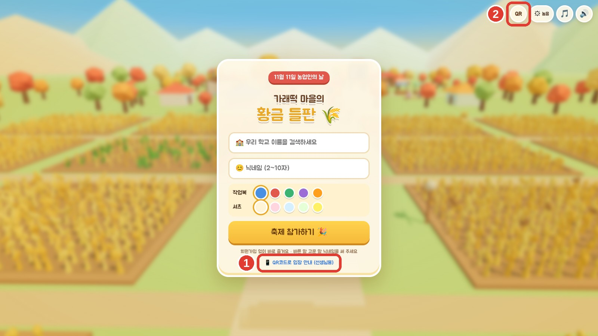

- **① 첫 화면 아래쪽** "📱 QR코드로 입장 안내 (선생님용)" 버튼
- **② 오른쪽 위 `QR` 버튼** — 첫 화면에서도, 게임 중에도 언제든 누를 수 있어요

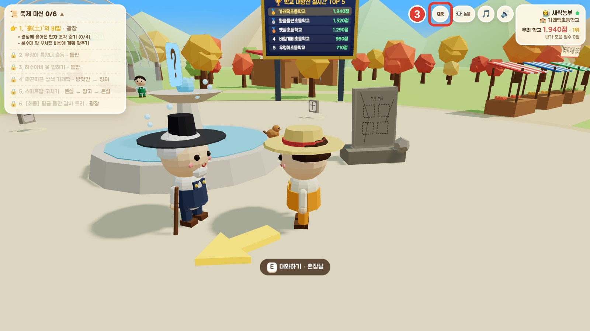

- **③ 게임하는 중에도** 오른쪽 위 `QR` 버튼으로 바로 띄울 수 있어서, 늦게 들어오는 친구가 있을 때 편해요

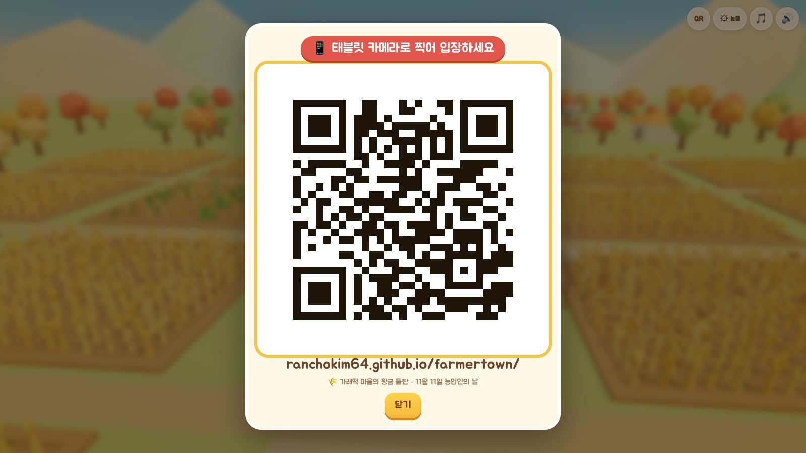

화면 크기에 맞춰 QR이 **최대한 크게** 나와서 교실 뒤쪽 자리에서도 잘 찍힙니다. 닫을 때는 `닫기`나 `Esc`, 바깥 아무 곳이나 누르면 돼요.

> 💡 **수업 전에 즐겨찾기 해 두세요!**
> **https://ranchokim64.github.io/farmertown/?qr** 로 열면 처음부터 QR 화면이 바로 뜹니다.
> (QR에는 `?qr` 없는 게임 주소가 들어 있어서, 아이들은 바로 게임 첫 화면으로 들어가요)

---

## 1. 시작: 학교 검색 + 닉네임만 입력하면 끝

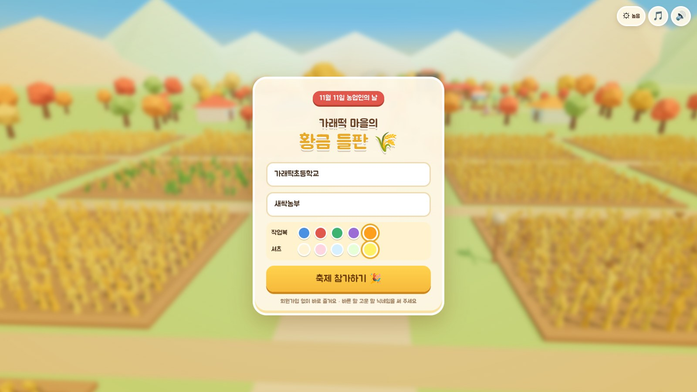

학교 이름을 검색해서 고르고, 닉네임을 정하고, 작업복 색을 고르면 바로 시작합니다.
- 닉네임은 **비속어 필터**가 있어서 우회 표현("시 1 발", "ㅅㅂ" 등)까지 걸러 줍니다.
- 새로고침하거나 창을 닫았다가 다시 들어와도 **"이어서 축제 즐기기"** 로 하던 곳부터 이어집니다.

## 2. 인트로: 구름을 뚫고 황금 들판으로!

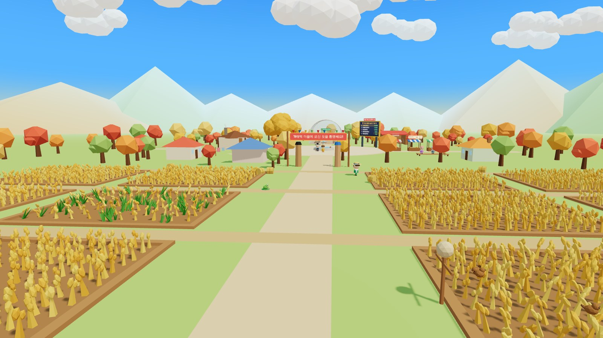
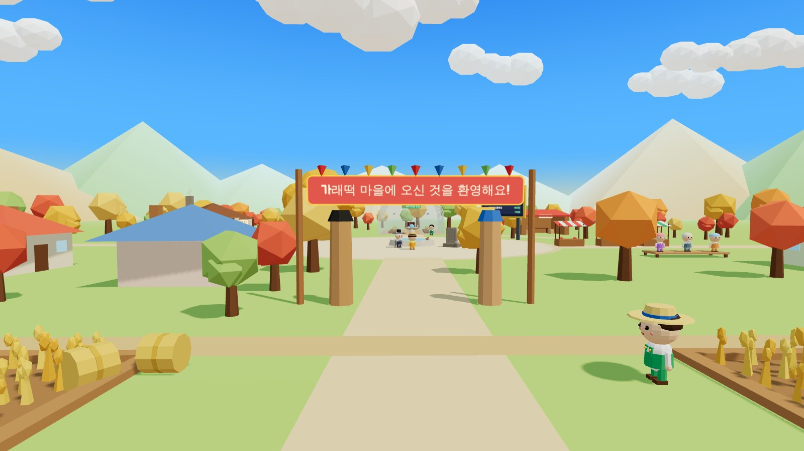

"축제 참가하기"를 누르면 카메라가 가을 하늘의 구름을 뚫고 내려와, 바람에 흔들리는 황금 들판 위를 날아
장승과 환영 현수막이 있는 마을 입구를 지나 내 캐릭터 등 뒤에 내려앉습니다.
첫 장면부터 아이들 반응이 아주 좋아요 😊 (배경음악도 국악 장단 느낌으로 직접 만들었습니다)

## 3. 촌장님과 함께하는 튜토리얼

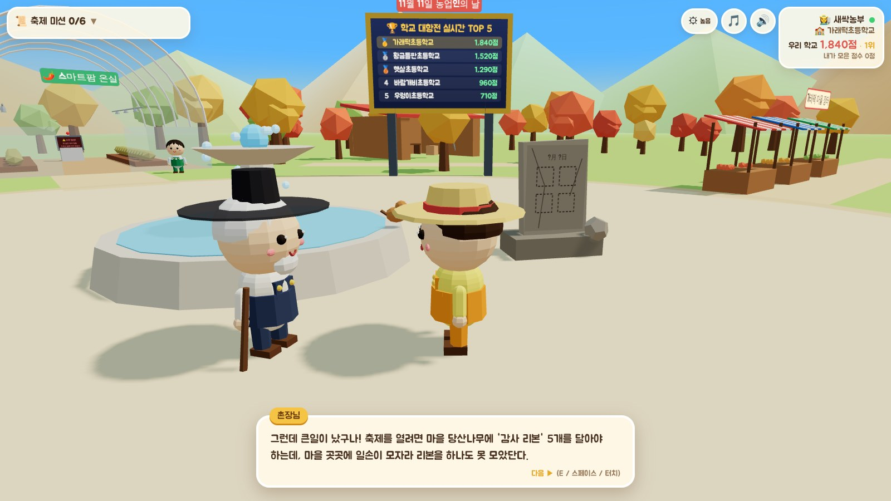

마을의 **촌장님**이 먼저 말을 걸어 오늘이 어떤 날인지, 왜 마을 사람들을 도와야 하는지 이야기해 줍니다.
> "축제를 열려면 마을 당산나무에 '감사 리본' 5개를 달아야 하는데, 일손이 모자라 리본을 하나도 못 모았단다…"

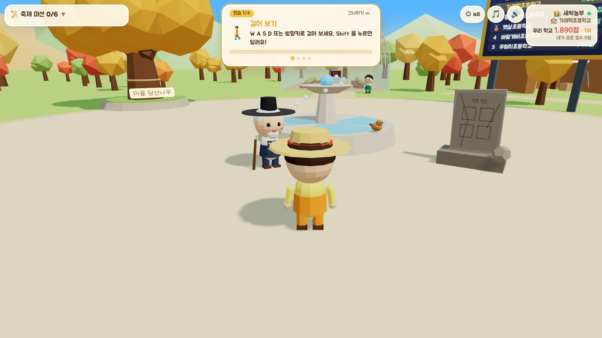

이어서 **걷기 → 둘러보기 → 말 걸기 → 물건 줍기**를 직접 해 보는 짧은 연습이 나옵니다.
게임이 처음인 아이도 위쪽 안내를 따라 하다 보면 자연스럽게 조작법을 익혀요.
발밑의 **노란 화살표**가 늘 다음 목적지를 가리켜 줘서 길을 잃지 않습니다.

---

## 4. 미션은 차례대로, 이야기가 이어집니다

미션 6개가 **하나씩 차례대로** 열리고, 앞 미션에서 만난 사람이 다음 사람에게 이어 줍니다.
머리 위에 ❗가 뜬 사람에게 말을 걸면 새 미션을 받을 수 있어요.

### 미션 1. '흙(土)'의 비밀 — 왜 11월 11일일까?

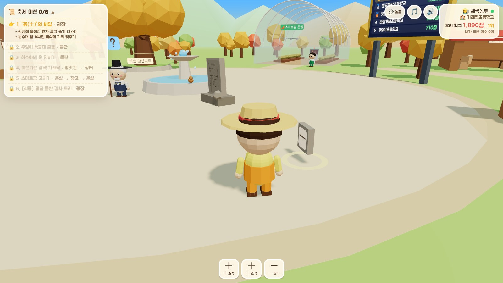
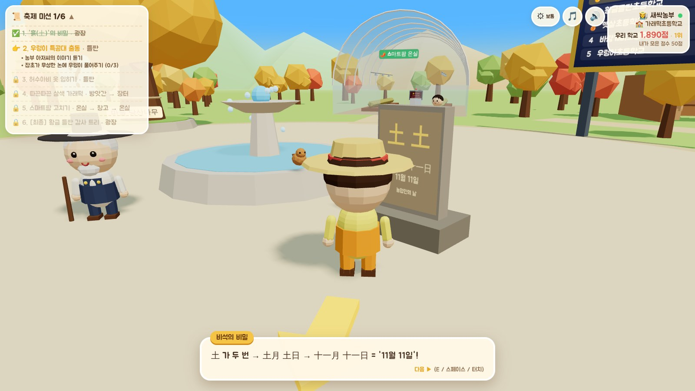

광장에 흩어진 **十(열 십) 2개, 一(한 일) 2개** 조각을 모아 부서진 비석에 끼우면,
흙 토(土) 자가 두 개 나타납니다. **土 = 十 + 一 → 土月 土日 → 十一月 十一日 = 11월 11일!**
"농업인은 흙에서 나서 흙과 더불어 살다 흙으로 돌아간다"는 의미를 아이들이 직접 퍼즐로 풀어 봅니다.

### 미션 2. 우렁이 특공대 출동 — 친환경 농업

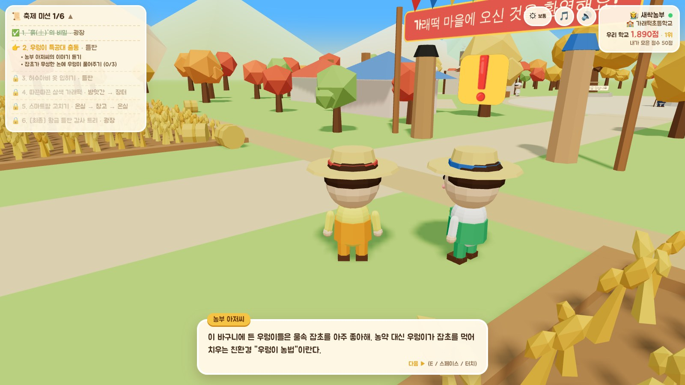
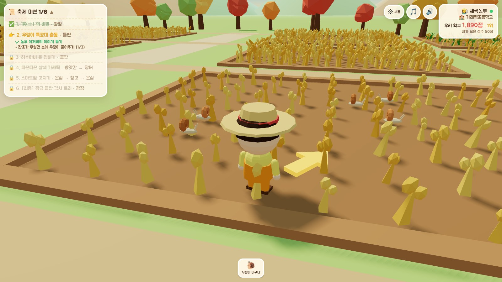

들판의 농부 아저씨에게 우렁이 바구니를 받아, 잡초가 무성한 논 3곳에 우렁이를 풀어 줍니다.
**농약 대신 우렁이가 잡초를 먹어 치우는 "우렁이 농법"** 을 알게 되고, 논에 우렁이가 꼬물꼬물 기어다니는 모습을 볼 수 있어요.

### 미션 3. 허수아비 옷 입히기 — 곡식을 지키는 지혜

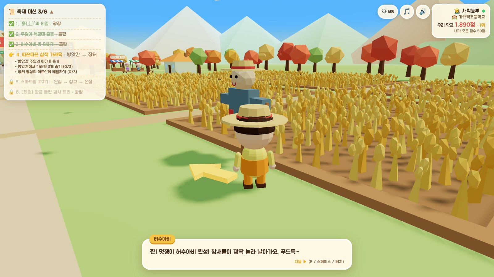

이번엔 참새 떼가 벼 이삭을 쪼아 먹고 있어요! 장터에서 밀짚모자를, 빨랫줄에서 낡은 셔츠를 찾아
허수아비에게 입히면 참새들이 푸드득 날아갑니다.

### 미션 4. 따끈따끈 삼색 가래떡 — 쌀이 우리 밥상에 오기까지

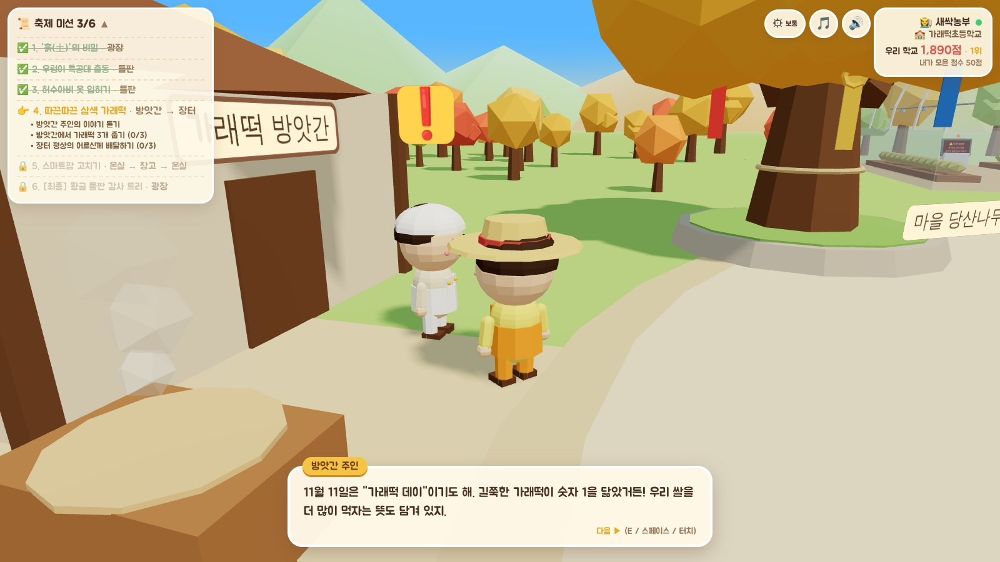
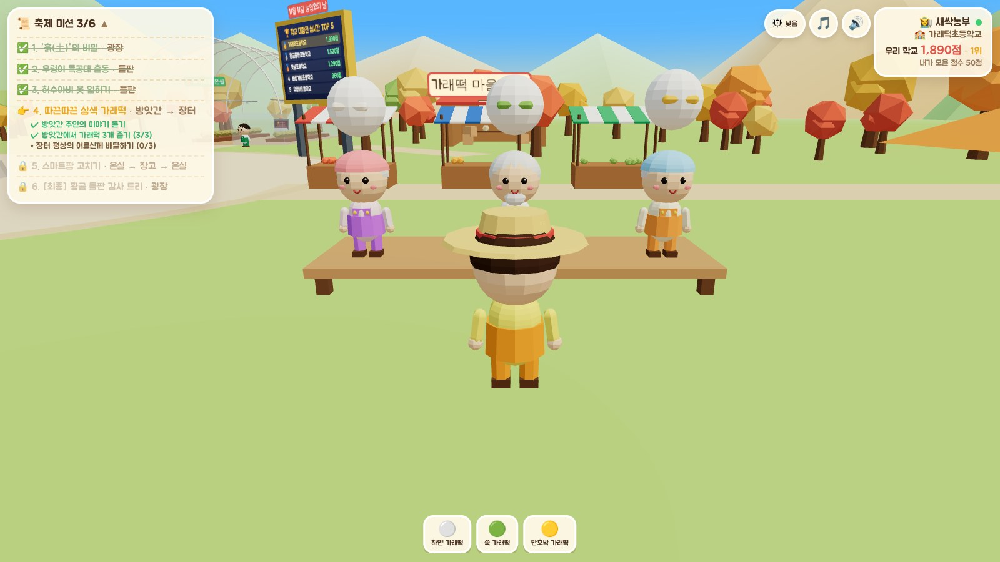

거둔 햅쌀은 방앗간으로! 방앗간 주인에게 **11월 11일 "가래떡 데이"** 이야기를 듣고,
하얀 떡·쑥 떡·단호박 떡을 장터 어르신 세 분께 배달합니다. 어르신마다 좋아하는 떡이 달라서 말풍선을 잘 봐야 해요.

### 미션 5. 스마트팜 고치기 — 미래의 농업

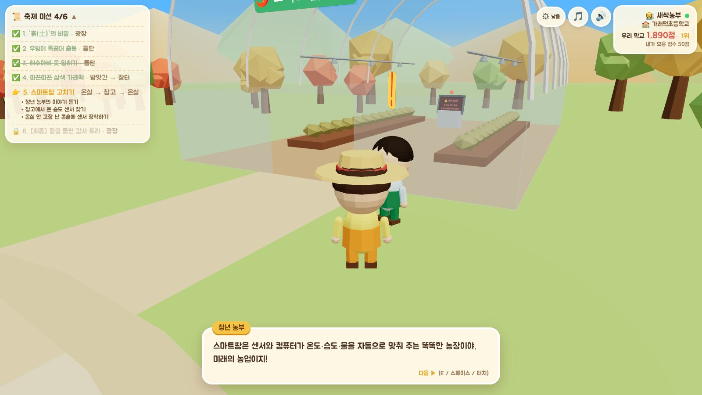
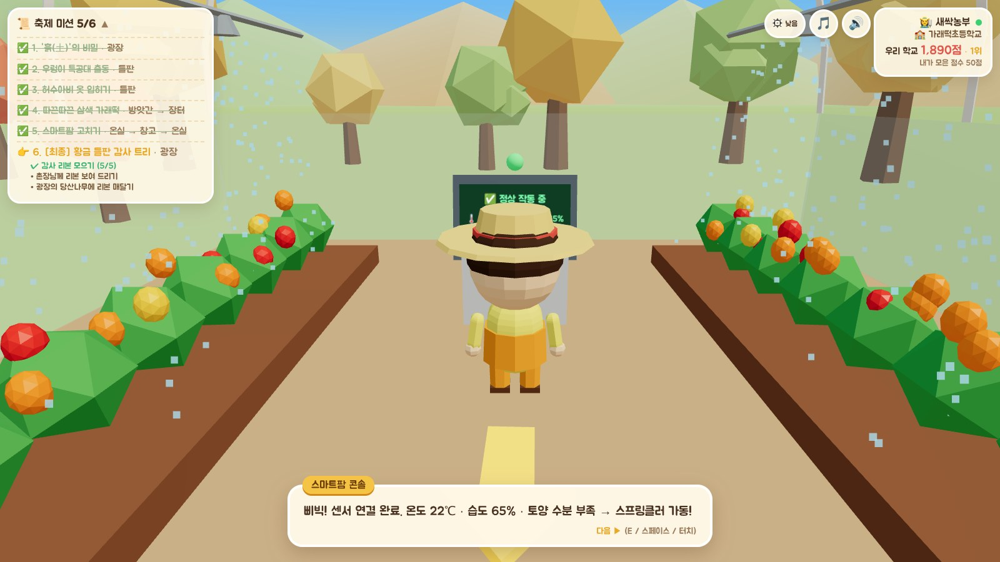

온실의 청년 농부가 도움을 요청해요. 창고에서 **온·습도 센서**를 찾아 콘솔에 끼우면 스프링클러가 돌아가고 파프리카가 쑥쑥 자랍니다.
센서와 컴퓨터로 농사짓는 **스마트팜**을 체험하면서 "옛날 농사 지혜 + 새로운 기술"로 이야기가 마무리돼요.

### 미션 6. 황금 들판 감사 트리 — 농업인께 감사하는 마음

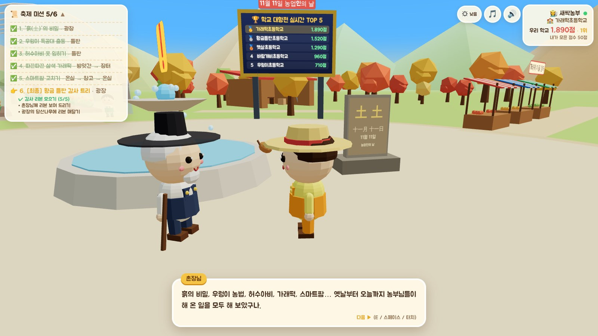

리본 5개를 모아 촌장님께 가면, 지금까지 해 온 일을 하나하나 되짚어 준 뒤 당산나무로 안내합니다.

---

## 5. 우리 학교를 응원해요! 학교 대항전

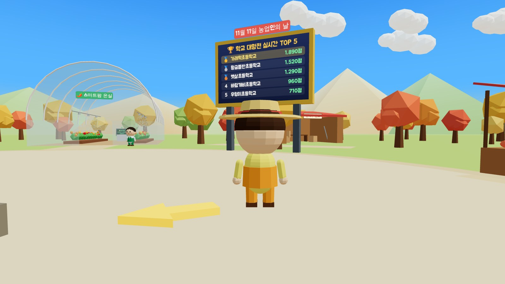

미션 하나에 10점, 엔딩까지 가면 50점이 **우리 학교 점수**로 쌓입니다.
광장의 대형 전광판에 **학교 순위 TOP 5** 가 실시간으로 나와서, 반 전체가 함께 점수를 올리는 재미가 있어요.
(같은 미션을 반복하거나 연타해도 점수는 한 번만 들어가도록 막아 두었습니다.)

## 6. 엔딩: 불꽃놀이와 명예의 전당

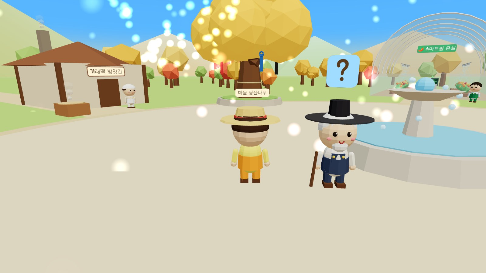

당산나무에 리본을 매달면 나무가 황금빛으로 빛나며 불꽃놀이가 펼쳐집니다 🎆
> "우리가 매일 먹는 밥 한 그릇에는 농업인의 땀과 정성이 담겨 있어요. 농업인 여러분, 고맙습니다!"

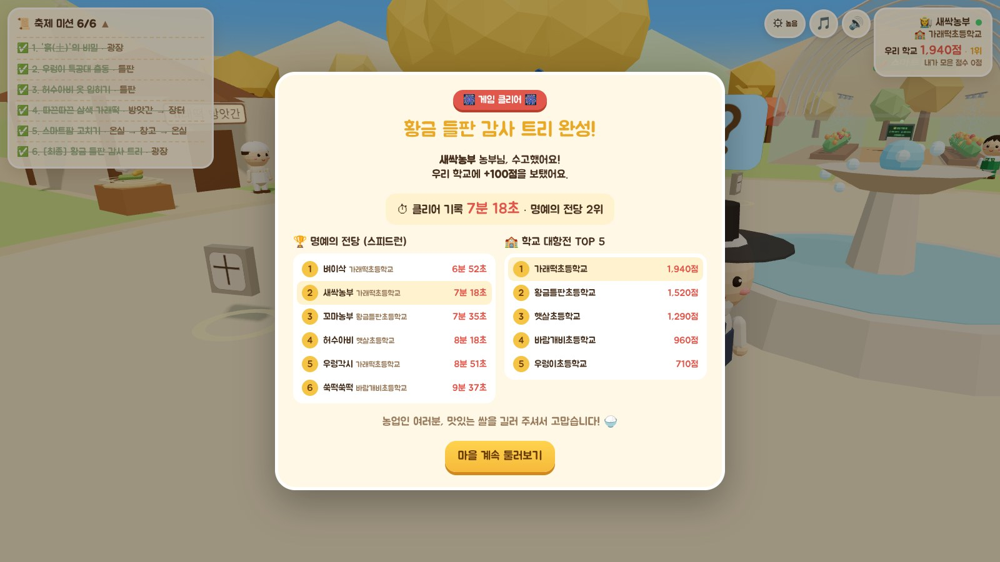

클리어 기록과 함께 **명예의 전당(빨리 깬 순위)** 과 학교 대항전 순위를 보여 줍니다.
엔딩 후에도 마을을 계속 돌아다닐 수 있어요.

## 7. 태블릿에서도 잘 돼요

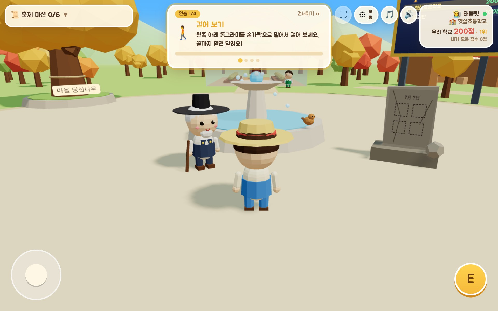

교실에서 많이 쓰는 **갤럭시 탭** 기준으로 맞춰 두었습니다.
- 왼쪽 조이스틱으로 이동(끝까지 밀면 달리기), 오른쪽 화면을 밀어 둘러보기, **E 버튼**으로 대화·줍기
- 시작하면 전체 화면으로 바뀌어 주소창이 사라지고, 가로·세로 모두 됩니다 (가로 권장)
- 기기가 버벅이면 자동으로 화질을 낮추고, 오른쪽 위 ⚙ 버튼으로 직접 바꿀 수도 있어요

---

## 🧑‍🏫 이렇게 활용해 보세요

1. **도입 (5분)** — "11월 11일은 무슨 날일까요?" 빼빼로데이 말고 다른 답이 나오는지 물어보기
2. **게임 (20~25분)** — 교실 화면에 QR을 띄우고 태블릿으로 찍어 입장, 같은 학교 이름으로 들어가 학교 점수 함께 올리기
3. **정리 (10분)** — 게임에서 알게 된 것 나누기, 농업인께 감사 카드 쓰기 (📄 아래 **활동지** 3쪽)

### 📄 함께 쓰는 활동지 (학생용·교사용, PDF / Word 첨부)

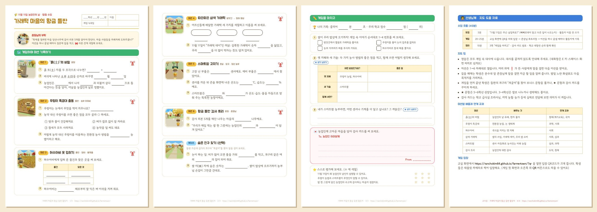

- **1~2쪽 미션 기록** — 미션을 하나 끝낼 때마다 빈칸 채우기·고르기로 정리하고 🎀 리본에 색칠해요.
  정답은 모두 게임 속 대사에 나와서, 대사를 꼼꼼히 읽는 습관도 함께 길러집니다.
- **3쪽 게임을 마치고** — 쌀이 밥상에 오기까지 순서 맞추기, 옛 지혜(우렁이·허수아비)와 새 기술(스마트팜) 비교,
  "내가 스마트팜 농부라면?", 농업인께 감사 카드, 스스로 평가
- **★ 생각 넓히기** 문항은 5~6학년용으로 표시해 두어 **3~6학년 한 장으로** 함께 쓸 수 있어요.
- **교사용**에는 정답(빨간 글씨)과 40분 수업 흐름, 지도 팁, 연계 교과표가 들어 있어요.
- **인쇄용 PDF**는 바로 A4로 출력하시면 되고, 문구를 고치고 싶으시면 **Word 파일**(한글에서도 열려요)을 쓰세요.

| 미션 | 배우는 것 | 연계해 볼 수 있는 교과 |
| --- | --- | --- |
| 흙(土)의 비밀 | 농업인의 날의 유래, 한자 풀이 | 창체(계기교육), 국어 |
| 우렁이 특공대 | 친환경 농업, 논 생태계 | 과학, 사회 |
| 허수아비 | 곡식을 지키는 옛 지혜 | 사회 |
| 삼색 가래떡 | 쌀의 쓰임, 가래떡 데이, 우리 쌀 소비 | 사회, 실과 |
| 스마트팜 | 센서와 자동화로 농사짓는 미래 농업 | 실과, 과학 |
| 감사 트리 | 농업인에 대한 감사 | 도덕, 창체 |

**💡 수업 팁**
- 소리가 겹쳐 교실이 시끄러우면 오른쪽 위 🎵(배경음악) / 🔊(효과음) 버튼으로 끌 수 있어요.
- 길을 헤매는 친구는 **분수대 앞 촌장님**께 말을 걸면 지금 어디로 가야 하는지 알려 줍니다.
- 개인정보 입력 없이 **학교 이름과 닉네임**만 씁니다. 실명 대신 별명으로 들어가도록 안내해 주세요.

---

만들면서 우리 반 아이들 얼굴을 떠올렸는데, 다른 반 아이들에게도 즐거운 농업인의 날이 되었으면 좋겠습니다.
써 보시고 불편한 점이나 아이디어가 있으면 댓글로 편하게 알려 주세요. 반영해 보겠습니다 🙏

🔗 **https://ranchokim64.github.io/farmertown/**
